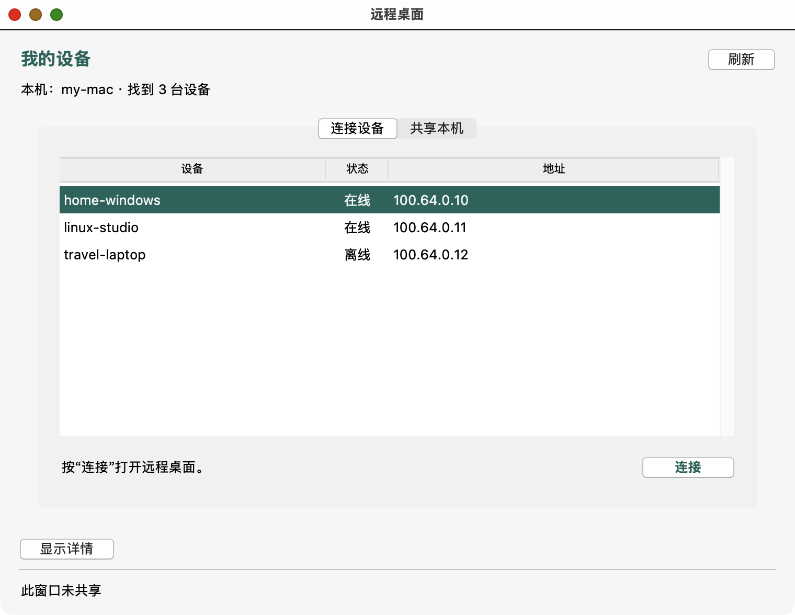

<h1 align="center">自用远程桌面</h1>

<p align="center">在外也能通过 Tailscale 连接家里的电脑，用键盘和鼠标操作它的桌面。</p>
<p align="center">
  
  
</p>

<p align="center">
  <a href="#快速开始">快速开始</a> ·
  <a href="#共享与授权">共享与授权</a> ·
  <a href="#平台限制">平台限制</a> ·
  <a href="#命令与排障">命令与排障</a> ·
  <a href="#目录结构">目录结构</a>
</p>

<p align="center"></p>

两台电脑运行同一份程序。家里的电脑开启共享，随身电脑打开查看窗口。要反向控制，交换两台电脑的操作即可。设备面板会列出同一 Tailscale 网络中可见的设备及其在线状态。

## 快速开始

两台电脑都需要连接同一个 [Tailscale 网络](https://tailscale.com/download)。打开 [GitHub Releases 下载页](https://github.com/Joylllll1/remote-desktop/releases/latest)，在 **Assets** 中为每台电脑选择对应的安装包。

| 平台 | 安装与启动 |
| --- | --- |
| Windows 10/11（x64） | 双击 `RemoteDesktop-Windows-x64.exe`，按提示安装，然后从开始菜单打开远程桌面应用。 |
| macOS | Apple 芯片选 `RemoteDesktop-macOS-arm64.dmg`，Intel 芯片选 `RemoteDesktop-macOS-x86_64.dmg`。打开镜像，把 `RemoteDesktop.app` 拖入“应用程序”，从那里启动。 |
| Ubuntu 24.04 / Debian 13（amd64） | 用系统软件安装器打开 `RemoteDesktop-Linux-amd64.deb`，或在文件所在目录运行 `sudo apt install ./RemoteDesktop-Linux-amd64.deb`，安装后从应用菜单启动。 |

Windows 和 macOS 包含 Python 和 Tk。Linux 由包管理器安装所需的系统依赖。当前自用构建未使用 Windows 发布者证书或 Apple 开发者公证，首次运行时系统可能提示确认来源。Mac 若提示无法验证开发者，可参阅 [Apple 的首次打开说明](https://support.apple.com/zh-cn/102445)。

两边都出现设备面板后：

1. **家里的 Windows 或 Linux**：打开「共享本机」，在「允许的设备」中选中随身 Mac，点击「开始共享」。保持电脑唤醒，保留共享窗口。
2. **随身 Mac**：打开「连接设备」，选中家里的电脑，点击「连接」。新窗口会显示对方的主屏幕，点进画面即可操作键鼠。
3. 临时离开时，在 Mac 上点「断开连接」，稍后可以再连。想结束本次共享，在家里的电脑上点「停止共享」。

<details>
<summary>从源码运行（开发时使用）</summary>

准备带 Tkinter 的 Python 3.12，在包含 `remote_desktop.py` 的项目目录执行以下命令。

**macOS 或 Linux 终端**

```sh
python3.12 -m venv .venv
.venv/bin/python -m pip install -r requirements.txt
.venv/bin/python remote_desktop.py
```

**Windows PowerShell**

```powershell
py -3.12 -m venv .venv
.\.venv\Scripts\python.exe -m pip install -r requirements.txt
.\.venv\Scripts\python.exe remote_desktop.py
```

</details>

## 共享与授权

每次开启共享时指定一台允许连接的设备。被控端通过 Tailscale 核对来源设备的稳定节点 ID，同名设备不能继承授权。

如果希望重启后继续使用，在被控端的「共享本机」页选好控制设备，再到「登录后自动共享」点击「启用所选设备」。下次登录图形桌面时，面板会打开并恢复共享。该设备以后重连时无需逐次在被控端确认。移动应用或源码目录后，需重新设置登录启动项。

## 平台限制

被控端需要开机、联网、保持唤醒，并有已登录的图形桌面。

| 被控端 | 首次使用须知 |
| --- | --- |
| macOS | 在「系统设置 → 隐私与安全性」中，为已安装的 RemoteDesktop 授予屏幕录制和辅助功能权限（从源码运行时，选择相应的终端或 Python），然后重新打开程序。 |
| Windows | 在已登录用户的桌面上运行。登录界面和 UAC 安全桌面不在控制范围内。 |
| Linux | 使用 X11 桌面会话。当前被控端不支持 Wayland。 |

Mac 控制 Linux X11 已在隔离环境中验证。Windows 安装、界面启动和卸载在 Wine 中测试过。Mac 控制 Windows 实机、反向控制 Mac 的完整键鼠会话，以及各系统重启登录后的恢复仍待实机验证。

## 命令与排障

使用源码时，下表中的参数接在 `remote_desktop.py` 后面。Linux 安装版可直接运行 `remote-desktop` 加参数；Mac 安装版使用 `/Applications/RemoteDesktop.app/Contents/MacOS/RemoteDesktop`。将 `travel-laptop` 和 `home-pc` 换成设备列表中的实际名称。重名时可用完整 DNS 名或 Tailscale IP。

| 参数 | 执行位置和结果 |
| --- | --- |
| `list` | 任一端。列出可见设备的名称、地址和在线状态。 |
| `host --allow travel-laptop` | 被控端。只允许指定电脑连接，按 Ctrl+C 停止共享。 |
| `connect home-pc` | 控制端。打开远程桌面窗口。若已另行配置 RustDesk，可追加 `--rustdesk` 调用其客户端。 |
| `check home-pc` | 控制端。连续连接两次，分别接收并解码一帧画面，输出分辨率和耗时，全程不发送键鼠事件。 |

**设备在线但连不上时**，先确认被控端面板显示「正在共享本机」，且允许的是当前控制设备。连接超时再检查主机防火墙和 Tailscale 访问规则是否允许控制端访问被控端的 TCP 47650。提示 `Stopped` 时先连接 Tailscale。若同时使用其他 VPN，可参考 [Tailscale 的共存说明](https://tailscale.com/docs/reference/faq/other-vpns)。

**出门前验证外网连接**，可以先让随身电脑切换到手机热点，运行 `check home-pc`。看到「首次连接成功」和「重新连接成功」后，打开远程窗口，在家中电脑的空白文本编辑器里输入一行字，确认画面和键鼠都可用。

完整命令选项见 `remote_desktop.py --help`。在项目目录中，用同一虚拟环境的 Python 执行 `-m unittest discover -v` 可运行仓库测试。[依赖清单](requirements.txt) · [会话协议测试](tests/test_session.py)

## 目录结构

```text
remote_desktop.py       启动图形面板或执行命令
remotedesk/
├── cli.py              解析命令，调用控制端或被控端
├── ui/                 设备面板和远程桌面窗口
├── host/               共享服务、屏幕采集和键鼠输入
├── network/            Tailscale 设备发现、连接和会话协议
└── login/              登录共享设置和系统自启动项
packaging/              Windows、macOS 和 Linux 安装包的构建脚本
tests/                  会话、授权、登录启动和平台行为测试
```

本地构建产物位于 `dist/`。维护者可按平台查看打包说明：[Windows](packaging/windows/README.md) · [macOS](packaging/macos/README.md) · [Linux](packaging/linux/README.md)。

## 许可证

[MIT 许可证](LICENSE)
